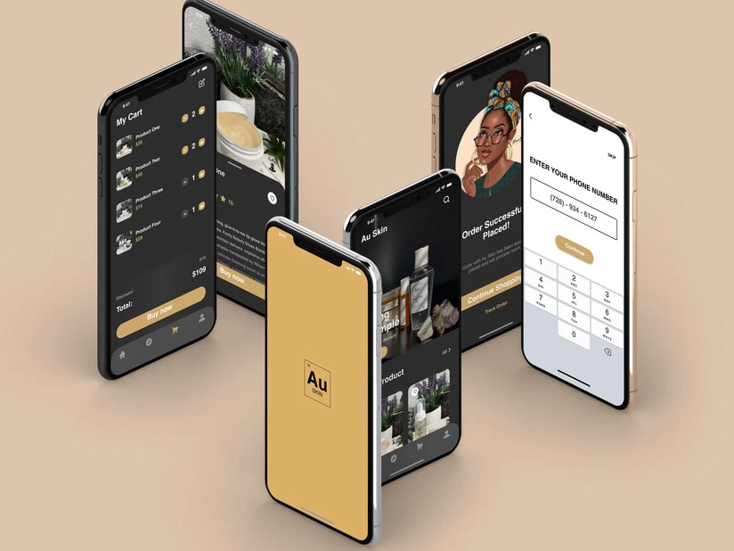

# Douglas Smallwood — Product Design Portfolio

A custom portfolio presenting my work across conversational AI, financial services, commerce, and complex product experiences.

**[Explore the live portfolio](https://www.douglassmallwood.me/)** · [LinkedIn](https://www.linkedin.com/in/douglas-smallwood/)

## Selected work

| Case study | Focus | Live page |
| --- | --- | --- |
| Beasy | Document authentication, digital trust, and product structure | [View case study](https://www.douglassmallwood.me/beasy/) |
| Chartway / Charley | Conversational clarity, self-service, and chat/voice journeys | [View case study](https://www.douglassmallwood.me/charley/) |
| Groundworks | Guided appointment booking and responsive interaction design | [View case study](https://www.douglassmallwood.me/groundworks/) |
| AU Gold Skin | Premium shopping experiences and mobile interface design | [View case study](https://www.douglassmallwood.me/au-gold-skin/) |

### A look at the work

AU Gold Skin — selected interface designs featured in the case study:



## What this repository demonstrates

- A responsive portfolio with individual case-study pages.
- Structured project storytelling, visual artifacts, and section navigation.
- Expandable project images using native HTML dialogs.
- Keyboard focus handling, accessible control labels, and reduced-motion support.
- Consistent outline social icons and thin-line SVG arrows.
- Static hosting, custom-domain routing, legacy URL redirects, and Git-triggered deployments.

## Design and implementation

The portfolio presents my design work, decisions, responsibilities, and reflections. The site was developed through an **AI-assisted workflow with ChatGPT/Codex**: I supplied project material and visual direction, reviewed iterations, and guided the final experience; the assistant helped write and refine the HTML, CSS, JavaScript, and deployment configuration.

The interface examples within the case studies are design artifacts, not interactive versions of those products. Project outcomes are described within each case study with the available context.

## Stack

| Technology | Purpose |
| --- | --- |
| HTML | Semantic page structure and project content |
| CSS | Responsive layouts, typography, and visual states |
| JavaScript | Case-study image dialogs and focus restoration |
| SVG | Outline icons and directional arrows |
| GitHub | Source control and revision history |
| Vercel | Static hosting, HTTPS, and automatic deployment |

No database, framework, package installation, or application build step is required.

## Run locally

From the repository root:

```bash
python3 -m http.server 8000 --directory dist
```

Open http://localhost:8000.

## Project structure

```text
dist/
  index.html
  style.css
  case.js
  assets/
  beasy/index.html
  charley/index.html
  groundworks/index.html
  au-gold-skin/index.html
vercel.json
```

## Editing and deployment

Open this repository in Cursor or another editor. Update the relevant page, shared stylesheet, image viewer, or assets, then preview locally.

The Vercel project `douglas-portfolio-live` is connected to this repository. Pushes to `main` trigger production deployments. Confirm the deployment succeeds and check the affected pages afterward.

The production address is https://www.douglassmallwood.me/. The root domain redirects to the www address. `vercel.json` configures the static output directory and redirects from previous case-study URLs.

## Content and reuse

This repository contains personal portfolio content and case-study artwork, including third-party brand names and visual materials. Public visibility does not grant permission to reuse those materials. No open-source license is granted by this repository; request permission before reusing code or assets.

## Contact

[LinkedIn](https://www.linkedin.com/in/douglas-smallwood/) · [dforartwork@gmail.com](mailto:dforartwork@gmail.com)
